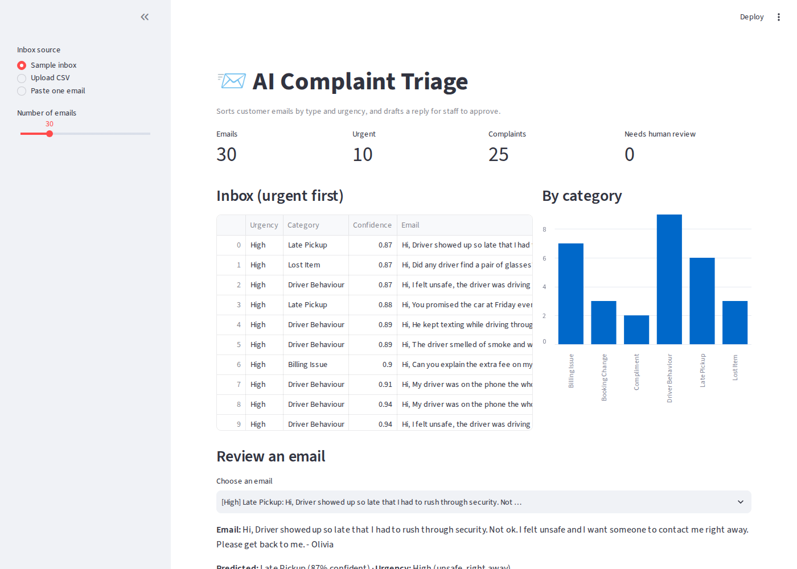
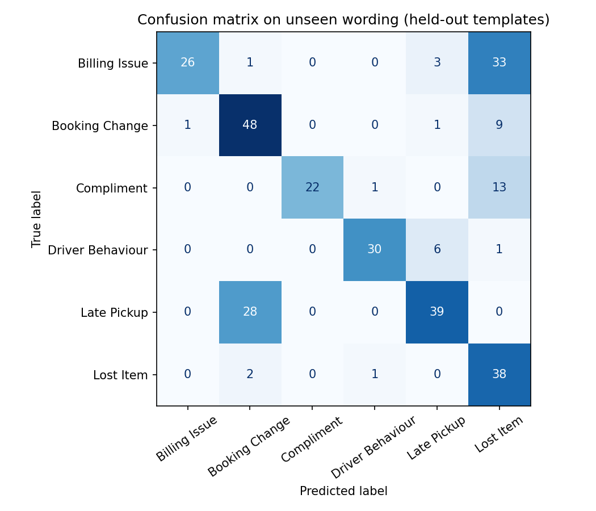

# 📨 AI Complaint Triage

A customer-service tool for a taxi & limousine company that **sorts incoming emails by type and urgency** and **drafts a reply for staff to approve**.

The idea came from real work: our team handles a high volume of calls, emails and complaints every day, and urgent issues can get lost in a busy inbox. This project shows how AI can handle the volume while **humans stay accountable for every reply**.



---

## ✨ What it does
1. **Classifies** each email into 6 categories: Late Pickup, Billing Issue, Driver Behaviour, Lost Item, Booking Change, Compliment
2. **Flags urgency** with transparent rules (safety words like *unsafe* or *speeding* are always urgent), and shows *why* it was flagged
3. **Sends low-confidence emails to "Needs review"** (below 60% confidence) instead of trusting the model blindly
4. **Drafts a reply grounded in company policy**, so it doesn't invent refunds or promises
5. **Human in the loop:** staff confirm the category, edit the draft and approve it

## 🧠 How it works
```
Email ──► Category model (TF-IDF + Logistic Regression) ──► category + confidence
      └─► Urgency rules (keywords) ─────────────────────────► High / Normal + reason
                                     │
                     Policy for that category (retrieval)
                                     ▼
                  Draft reply (template, or LLM if API key set)
                                     ▼
                      Staff review ──► Approve
```
- **Category model:** word and word-piece TF-IDF features with Logistic Regression. Fast, cheap and explainable: you can see which words drive each category.
- **Urgency:** simple keyword rules, chosen on purpose so staff can see exactly why an email is urgent.
- **Drafts:** by default a template built from the policy. If `ANTHROPIC_API_KEY` is set, an LLM writes the draft **using only the policy text as context** (the idea behind RAG). If the API fails, it falls back to the template.

## 📊 Results
| Evaluation | Accuracy |
|---|---|
| Random split | 100% (too optimistic, see below) |
| **Unseen wording** (2 sentence patterns per category held out) | **67%** |
| Urgency rules vs. labels | 98.6% |

**Why two numbers?** With a random split, test emails share sentence patterns with training emails, so the model just recognises them: 100% looks great but means nothing. Holding out whole sentence patterns tests how it handles **new wording**, which is what real customers write. 67% is an honest baseline, and it shows why the app routes uncertain emails to a human and why an LLM could improve accuracy on varied wording.



Full per-category scores: [`reports/metrics.md`](reports/metrics.md)

## 📁 Data
Real customer emails contain personal information, so this project uses **1,150 synthetic emails** generated from 48 realistic sentence patterns, with names, places, amounts, extra context and urgent wording mixed in (`data/generate_data.py`).

## ▶️ How to Run
```bash
git clone https://github.com/samhadd-ad/ai-complaint-triage.git
cd ai-complaint-triage
pip install -r requirements.txt

python data/generate_data.py   # creates data/emails.csv
python train.py                # trains the model, writes reports/
streamlit run app.py           # opens the review app
pytest                         # runs the tests
```
**Optional LLM drafts:** `pip install anthropic`, then set `ANTHROPIC_API_KEY` before starting the app.

## 📁 Project Structure
```
├── app.py                  # Streamlit review app
├── train.py                # training + honest evaluation
├── data/generate_data.py   # synthetic inbox generator
├── triage/
│   ├── classifier.py       # TF-IDF + Logistic Regression, explainability
│   ├── urgency.py          # urgency rules with reasons
│   ├── policies.py         # company policy text (retrieval source)
│   └── drafts.py           # template or LLM draft replies
├── reports/                # metrics, confusion matrix, screenshot
└── tests/                  # pytest tests
```

## 🔒 Responsible AI choices
- **Human approval** before any reply is sent
- **Confidence threshold:** uncertain emails go to a person
- **Explainable:** urgency shows its reasons; the model shows its key words
- **Grounded drafts:** replies only use approved policy text
- **Privacy:** synthetic data only; with real data, use an enterprise AI service and never a public chatbot

## 🔮 Next Steps
- Train on real (anonymised) emails
- Compare against an LLM classifier on the same unseen-wording test
- Read emails directly from Outlook (Microsoft Graph API)
- Power BI dashboard of complaint trends and response times

## 🧰 Tech
Python · scikit-learn · pandas · Streamlit · pytest · (optional) Claude API
